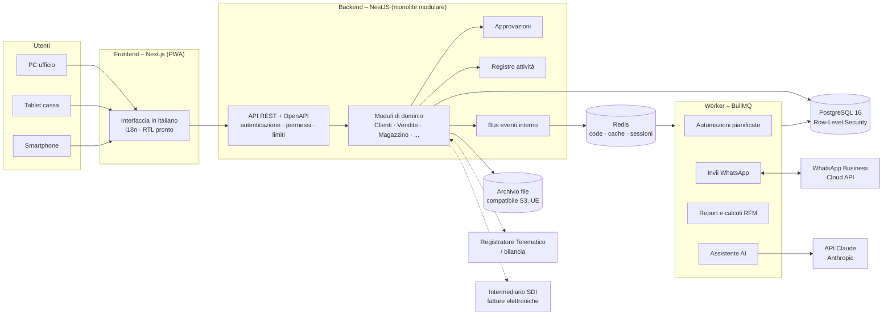

# 02 – Architettura generale e stack tecnologico

## 1. Principi architetturali

1. **Monolite modulare**: un'unica applicazione backend suddivisa in moduli con confini netti (dominio, servizi, API). Più semplice da gestire di una rete di microservizi, ma separabile in futuro se serve.
2. **Multi-azienda fin dall'inizio**: ogni dato appartiene a un'azienda (`tenant`). Anche se oggi c'è una sola azienda, l'isolamento è applicato dal database stesso.
3. **API prima di tutto**: il frontend usa le stesse API documentate (OpenAPI) che potranno servire app future, integrazioni e l'assistente AI.
4. **Sicurezza per impostazione predefinita**: permessi verificati lato server, mai solo nell'interfaccia.
5. **Eventi di dominio**: le azioni importanti (vendita registrata, lotto ricevuto, consenso revocato) generano eventi che alimentano automazioni, statistiche e registro attività senza accoppiare i moduli.
6. **Umano nel ciclo**: ogni operazione sensibile passa da un flusso di approvazione centralizzato.
7. **Internazionalizzazione nativa**: nessun testo nel codice; formati di data, numero e valuta secondo la lingua (it-IT predefinito).

## 2. Schema generale



Le linee tratteggiate sono integrazioni da confermare in base all'hardware e ai servizi del negozio.

## 3. Stack tecnologico consigliato

### 3.1 Frontend

| Componente | Scelta | Perché |
|---|---|---|
| Framework | **Next.js** (React, App Router) | Maturo, veloce, ampia comunità |
| Linguaggio | **TypeScript** | Errori intercettati prima dell'esecuzione |
| Stile | **Tailwind CSS** + componenti **shadcn/ui** (basati su Radix) | Accessibili, personalizzabili, supporto RTL |
| Traduzioni | **next-intl** (formato ICU) | Plurali, date, valute; aggiunta lingue senza codice |
| Dati | **TanStack Query** | Cache, aggiornamenti ottimistici, modalità offline parziale |
| Moduli | **React Hook Form** + **Zod** | Validazione condivisa con il backend |
| Grafici | **Recharts** o **ECharts** | Dashboard e report |
| PWA | Service worker | Installazione su tablet, lavoro con connessione instabile |

### 3.2 Backend

| Componente | Scelta | Perché |
|---|---|---|
| Framework | **NestJS** (Node.js LTS) | Struttura a moduli, iniezione dipendenze, ottimo per progetti grandi |
| ORM | **Prisma** | Schema leggibile, migrazioni versionate, tipizzazione automatica |
| Validazione | **Zod** (schemi condivisi) | Stesse regole tra frontend e backend |
| Documentazione API | **OpenAPI / Swagger** generata | Contratto chiaro per integrazioni |
| Code di lavoro | **BullMQ** su **Redis** | Ritenti, pianificazioni, limiti di frequenza |
| Log | **Pino** (JSON strutturato) | Ricerca e monitoraggio |
| PDF | Generazione server-side (es. Playwright/Chromium headless) | Report e cartellini fedeli al layout |
| Excel/CSV | **ExcelJS** | Esportazioni per il commercialista |

### 3.3 Dati

| Componente | Scelta | Perché |
|---|---|---|
| Database | **PostgreSQL 16** | Transazioni affidabili, JSON, ricerca testuale, Row-Level Security |
| Isolamento aziende | Colonna `tenant_id` + **policy RLS** | Difesa a livello di database, non solo applicativo |
| Ricerca | `pg_trgm` (ricerca tollerante agli errori) | Trovare "Mario Rosi" anche scrivendo "Rossi" |
| Cache / sessioni | **Redis** | Velocità |
| File | Archivio **compatibile S3** in UE, cifrato | Foto prodotti, documenti fornitori, esportazioni |

### 3.4 Integrazioni esterne

| Integrazione | Soluzione proposta | Note |
|---|---|---|
| WhatsApp | **WhatsApp Business Platform – Cloud API** (ufficiale Meta), direttamente o tramite un BSP europeo | Serve un numero dedicato e la verifica dell'azienda su Meta Business |
| Registratore Telematico | Integrazione con il protocollo del modello in uso (molti RT supportano comandi via rete, es. XON/XOFF o protocolli proprietari) **oppure** importazione dei corrispettivi | Dipende dal modello: domanda bloccante |
| Bilancia | Lettura peso via seriale/USB/rete oppure codice a barre a peso variabile (EAN-13 con prefisso 2x) | Dipende dal modello |
| Fattura elettronica | Intermediario accreditato SDI con API (da scegliere con il commercialista) | Solo se ci sono clienti professionali |
| Recensioni | Link alla scheda Google dell'attività | Nessuna pubblicazione automatica |
| AI | **API Claude (Anthropic)** | Vedi §5 |
| Email transazionali | Fornitore SMTP con sede/server in UE | Recupero password, report programmati |

### 3.5 Strumenti di sviluppo e qualità

- Monorepo **pnpm** + **Turborepo** (`apps/web`, `apps/api`, `apps/worker`, `packages/shared`, `packages/i18n`).
- **ESLint**, **Prettier**, controllo dei tipi in CI.
- Test: **Vitest**, **Supertest**, **Testcontainers** (PostgreSQL reale nei test), **Playwright** (end-to-end), **axe** (accessibilità), **k6** (carico).
- **GitHub Actions** per integrazione e rilascio continui.
- **Docker** per ambienti identici tra sviluppo, collaudo e produzione.
- Analisi di sicurezza: Dependabot/Renovate, `npm audit`, scansione immagini container, analisi statica (CodeQL).

## 4. Struttura del codice (proposta)

```
crm-ibra/
├── apps/
│   ├── web/            # Next.js – interfaccia
│   ├── api/            # NestJS – API e logica di dominio
│   │   └── src/modules/
│   │       ├── identita/        # utenti, autenticazione, ruoli
│   │       ├── aziende/         # tenant, sedi, impostazioni
│   │       ├── clienti/
│   │       ├── segmenti/
│   │       ├── prodotti/
│   │       ├── listini/
│   │       ├── magazzino/
│   │       ├── vendite/
│   │       ├── ordini/
│   │       ├── fornitori/
│   │       ├── whatsapp/
│   │       ├── campagne/
│   │       ├── fedelta/
│   │       ├── recensioni-referral/
│   │       ├── automazioni/
│   │       ├── assistente-ai/
│   │       ├── report/
│   │       ├── approvazioni/
│   │       ├── consensi/
│   │       └── registro-attivita/
│   └── worker/         # processi in background
├── packages/
│   ├── shared/         # tipi, schemi Zod, costanti
│   ├── i18n/           # it.json (predefinita), en.json, ar.json
│   └── ui/             # componenti grafici comuni
├── prisma/             # schema e migrazioni
├── docs/               # documentazione tecnica e manuale utente
└── infra/              # Docker, configurazioni di deploy
```

Nota sui nomi: i **nomi dei moduli e della documentazione sono in italiano**; i nomi di variabili e tabelle nel codice saranno in inglese tecnico (convenzione che facilita l'uso di librerie e il lavoro di futuri sviluppatori), mentre **tutto ciò che vede l'utente è in italiano**.

## 5. Architettura dell'Assistente AI

### 5.1 Scelte

- **Modello**: `claude-opus-5-5` (Anthropic) con ragionamento adattivo; livello di "effort" regolato per tipo di richiesta (basso per domande semplici, alto per analisi).
- **Integrazione**: SDK ufficiale `@anthropic-ai/sdk` con ciclo di strumenti gestito dal nostro backend (Tool Runner), così **i dati e il controllo delle azioni restano nel nostro sistema**.
- **Fallback** lato server attivato in caso di rifiuto del modello, per non lasciare l'utente senza risposta.
- **Prompt caching** sulle istruzioni di sistema e sulle definizioni degli strumenti per ridurre costi e tempi.

### 5.2 Strumenti messi a disposizione dell'AI

| Tipo | Esempi | Esecuzione |
|---|---|---|
| Lettura | `cerca_clienti`, `vendite_per_periodo`, `giacenze`, `lotti_in_scadenza`, `andamento_prodotto` | Automatica, **con i permessi dell'utente che chiede** |
| Proposta | `proponi_ordine_fornitore`, `proponi_campagna`, `proponi_prezzo` | Crea una **richiesta di approvazione**, non esegue nulla |
| Bozza | `bozza_messaggio_whatsapp`, `bozza_descrizione_prodotto` | Restituisce testo da revisionare |

Non esistono strumenti AI per: inviare messaggi, modificare prezzi, cancellare dati, registrare vendite o movimenti di denaro.

### 5.3 Garanzie

- Le query degli strumenti passano dagli stessi controlli di permesso e dall'isolamento per azienda delle API normali.
- I dati personali inviati al modello sono ridotti al minimo (pseudonimizzazione dove possibile; ad esempio, per analisi aggregate non si inviano nomi o telefoni).
- Ogni risposta mostra quali strumenti/dati sono stati consultati.
- Le conversazioni con l'AI sono registrate (con conservazione limitata) per controllo e miglioramento.
- L'uso dell'AI è dichiarato agli utenti (trasparenza AI Act).
- Il trattamento con Anthropic richiede un accordo sul trattamento dei dati (DPA) e la verifica della localizzazione dei dati; il modulo è disattivabile per azienda.

## 6. Modalità offline in cassa (da confermare)

Se la connessione del negozio non è affidabile, la schermata di vendita salverà le vendite localmente (IndexedDB) e le sincronizzerà al ritorno della rete, con identificativi univoci generati sul dispositivo per evitare duplicati. Decisione da prendere in base alla risposta sulla qualità della connessione.

## 7. Scalabilità multi-azienda

- Un'unica installazione serve più aziende (modello SaaS) con isolamento RLS.
- Possibilità di installazione dedicata per un cliente che lo richieda.
- Impostazioni per azienda: lingua, valuta, aliquote IVA, moduli attivi, marchio (logo e colori), numero WhatsApp, regole fedeltà.
- Moduli attivabili/disattivabili per azienda (predisposizione a piani commerciali).
- Supporto a più sedi/punti vendita per azienda.
