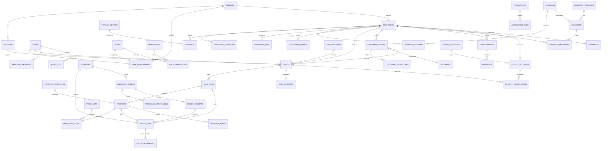

# 03 – Progettazione del database e relazioni tra entità

## 1. Convenzioni

- **PostgreSQL 16**, schema gestito con migrazioni Prisma versionate.
- Chiavi primarie **UUID v7** (ordinabili nel tempo, generabili anche offline sul tablet).
- Ogni tabella di dominio contiene: `tenant_id`, `created_at`, `updated_at`, `created_by`, `updated_by`; dove serve `deleted_at` (cancellazione logica).
- **Importi** in centesimi di euro come interi (`amount_cents`), mai numeri decimali in virgola mobile.
- **Quantità** in `NUMERIC(12,3)` con unità esplicita (kg con 3 decimali = grammi).
- Date e ore in UTC (`timestamptz`), visualizzate nel fuso `Europe/Rome`.
- **Row-Level Security** attiva su tutte le tabelle con `tenant_id`.
- Campo `data_origin` (`reale` | `importato` | `dimostrativo`) dove utile; in produzione i dati dimostrativi esistono **solo** nel tenant demo.
- Dati personali sensibili (es. note su allergie) cifrati a livello di colonna.

## 2. Aree del modello dati

### 2.1 Piattaforma, identità e sicurezza

| Tabella | Contenuto principale |
|---|---|
| `tenants` | Azienda: ragione sociale, P.IVA, impostazioni, lingua, moduli attivi, stato |
| `locations` | Sedi/punti vendita del tenant |
| `users` | Utente: email, nome, hash password (Argon2id), stato, lingua preferita |
| `user_memberships` | Collegamento utente–tenant con ruolo (un utente può lavorare per più aziende) |
| `roles` | Ruoli predefiniti e personalizzati per tenant |
| `permissions` | Catalogo dei permessi (es. `vendite.reso`) |
| `role_permissions` | Associazione ruolo–permesso |
| `sessions` | Sessioni attive, dispositivo, IP, scadenza |
| `mfa_factors` | Secondo fattore (TOTP, passkey) |
| `api_keys` | Chiavi per integrazioni (hash), ambito, scadenza |
| `audit_logs` | Registro attività: chi, cosa, quando, valori prima/dopo, IP. **Solo inserimento** |
| `approval_requests` | Richieste di approvazione: tipo, dati proposti, richiedente (utente o AI), stato, approvatore, motivazione |

### 2.2 Clienti, consensi, segmenti

| Tabella | Contenuto principale |
|---|---|
| `customers` | Tipo (privato/azienda), nome, cognome, ragione sociale, telefono (E.164), email, codice fiscale, P.IVA, SDI/PEC, data nascita (facoltativa), stato, fonte acquisizione |
| `customer_addresses` | Indirizzi di consegna/fatturazione |
| `customer_notes` | Note interne con autore |
| `customer_preferences` | Preferenze (biologico, prodotti preferiti, orari) |
| `consents` | Storico consensi: finalità (servizio, marketing, profilazione, recensioni), canale, stato, data, fonte, versione informativa, prova (es. messaggio WhatsApp) |
| `privacy_notices` | Versioni delle informative privacy |
| `data_subject_requests` | Richieste GDPR (accesso, cancellazione…) con scadenze |
| `tags`, `customer_tags` | Etichette |
| `segments` | Segmento: tipo (dinamico/statico), regole in JSON |
| `segment_members` | Membri dei segmenti statici / istantanea di quelli dinamici |
| `customer_metrics` | Indicatori calcolati: RFM, ultima visita, spesa totale, frequenza media, rischio abbandono |

### 2.3 Prodotti e listini

| Tabella | Contenuto principale |
|---|---|
| `product_categories` | Albero categorie (Frutta › Agrumi › Arance) |
| `products` | Nome, varietà, categoria, unità di vendita (kg, pezzo, mazzo, confezione, cassetta), PLU, EAN, aliquota IVA, origine predefinita, categoria commerciale, biologico, stagionalità, attivo |
| `product_units` | Conversioni (es. 1 cassetta = 10 kg) |
| `vat_rates` | Aliquote IVA configurabili per tenant (valori da confermare con il commercialista) |
| `price_lists` | Listini (banco, professionali, promozione) con validità |
| `price_list_items` | Prezzo per prodotto e listino, con validità |
| `price_history` | Storico prezzi di vendita e acquisto |
| `promotions` | Promozioni (sconto %, prezzo fisso, 3x2) con periodo e condizioni |

### 2.4 Magazzino

| Tabella | Contenuto principale |
|---|---|
| `stock_lots` | Lotto: prodotto, fornitore, data arrivo, quantità iniziale, costo unitario, origine, categoria, data limite consigliata, riferimento DDT |
| `stock_movements` | Movimento: tipo (carico, vendita, reso, scarto, calo, rettifica, trasferimento), quantità ±, lotto, causale, documento collegato |
| `stock_levels` | Giacenza aggregata per prodotto/sede (vista materializzata o tabella aggiornata da trigger) |
| `waste_reasons` | Motivi di scarto (deperimento, danneggiato, invenduto, omaggio…) |
| `inventory_counts`, `inventory_count_lines` | Sessioni di inventario |
| `reorder_rules` | Soglia minima, quantità di riordino, fornitore preferito |

### 2.5 Vendite

| Tabella | Contenuto principale |
|---|---|
| `sales` | Vendita: sede, operatore, cliente (facoltativo), data/ora, totale lordo, sconti, totale, stato, riferimento documento RT (numero, data, matricola), origine (cassa, ordine) |
| `sale_lines` | Riga: prodotto, lotto, quantità, unità, prezzo unitario, sconto, IVA, importo |
| `sale_payments` | Metodo e importo registrato (nessun incasso gestito dal sistema) |
| `sale_returns`, `sale_return_lines` | Resi con motivo e approvazione |
| `cash_sessions` | Apertura/chiusura cassa, fondo, totali attesi e contati, differenze |
| `fiscal_daily_totals` | Corrispettivi giornalieri importati dall'RT per riconciliazione |

### 2.6 Ordini e fornitori

| Tabella | Contenuto principale |
|---|---|
| `suppliers` | Ragione sociale, P.IVA, contatti, condizioni di pagamento, giorni di consegna |
| `supplier_products` | Prodotti forniti, codice fornitore, prezzo di acquisto corrente |
| `supplier_ratings` | Valutazioni periodiche (qualità, puntualità, % scarto) |
| `purchase_orders`, `purchase_order_lines` | Ordini d'acquisto con stato |
| `goods_receipts`, `goods_receipt_lines` | Ricevimento merce → genera `stock_lots` |
| `supplier_documents` | DDT e fatture d'acquisto (metadati + file) |
| `customer_orders`, `customer_order_lines` | Ordini/prenotazioni clienti: tipo (ritiro, consegna), data richiesta, stato, canale (negozio, telefono, WhatsApp) |
| `deliveries` | Consegne: indirizzo, fascia oraria, incaricato, esito |

### 2.7 Comunicazione e marketing

| Tabella | Contenuto principale |
|---|---|
| `whatsapp_accounts` | Numero e configurazione del tenant (token cifrati in un gestore segreti, non nel DB in chiaro) |
| `conversations` | Conversazione per cliente e canale, stato, assegnatario, ultima attività, finestra 24h |
| `messages` | Messaggio: direzione, contenuto, tipo, stato (inviato, consegnato, letto, fallito), ID esterno |
| `message_templates` | Modelli con categoria Meta (marketing, utilità, autenticazione), lingua, stato approvazione |
| `quick_replies` | Risposte rapide per operatori |
| `campaigns` | Campagna: segmento, canale, modello, programmazione, stato (bozza, in approvazione, approvata, in invio, completata, annullata), approvatore |
| `campaign_recipients` | Destinatario, esito, motivo esclusione (es. nessun consenso) |
| `communication_limits` | Limiti di frequenza per tenant e cliente |

### 2.8 Fedeltà, recensioni, referral

| Tabella | Contenuto principale |
|---|---|
| `loyalty_programs` | Regolamento, regole di accumulo, scadenza punti, versione |
| `loyalty_accounts` | Conto punti del cliente, numero tessera/QR, saldo |
| `loyalty_transactions` | Accrediti, riscatti, scadenze, rettifiche (registro immutabile) |
| `rewards` | Premi e soglie |
| `review_requests` | Richieste di recensione inviate, esito |
| `feedback` | Valutazioni interne |
| `referral_codes`, `referrals` | Codici e presentazioni, stato, premio assegnato |

### 2.9 Automazioni, AI, sistema

| Tabella | Contenuto principale |
|---|---|
| `automations` | Regola: evento scatenante o pianificazione, condizioni, azioni, attiva, richiede approvazione |
| `automation_runs` | Esecuzioni con esito ed errori |
| `domain_events` | Eventi di dominio (outbox) per affidabilità delle automazioni |
| `ai_conversations`, `ai_messages` | Dialoghi con l'assistente, strumenti usati, costo in token |
| `notifications` | Notifiche interne agli utenti |
| `files` | Metadati file (archivio S3) |
| `report_definitions`, `report_runs` | Report salvati e generati |
| `settings` | Impostazioni chiave/valore per tenant |

## 3. Diagramma delle relazioni principali

## 4. Regole di integrità principali

1. Una vendita confermata **non si modifica**: si corregge con un reso o un annullamento tracciato.
2. I movimenti di magazzino e di punti fedeltà sono **registri immutabili**; la giacenza e il saldo si ricavano dai movimenti.
3. La giacenza di un lotto non può diventare negativa senza un'autorizzazione esplicita (configurabile, per non bloccare la cassa).
4. Un messaggio di marketing può essere inviato solo se esiste un consenso `marketing` + canale `whatsapp` **attivo alla data dell'invio**; il controllo avviene nel momento dell'invio, non solo alla creazione della campagna.
5. La revoca di un consenso ha effetto immediato e annulla gli invii in coda.
6. La cancellazione di un cliente su richiesta GDPR lo **anonimizza** (le vendite restano per obblighi fiscali, senza dati personali).
7. Ogni `approval_request` approvata conserva l'istantanea dei dati approvati: se nel frattempo cambiano, serve una nuova approvazione.

## 5. Indici e prestazioni

- Indici composti con `tenant_id` in prima posizione.
- Ricerca clienti: indice trigramma su nome e telefono normalizzato.
- Vendite: indice su (`tenant_id`, `location_id`, `sold_at`).
- Statistiche pesanti calcolate dal worker in tabelle di aggregazione giornaliera (`daily_sales_summary`, `daily_product_summary`) per dashboard rapide.
- Partizionamento per mese di `audit_logs` e `messages` quando i volumi lo richiederanno.

## 6. Conservazione dei dati (proposta, da validare)

| Dato | Conservazione | Motivo |
|---|---|---|
| Vendite e documenti contabili | 10 anni | Obblighi civilistici e fiscali (art. 2220 c.c.) |
| Dati per marketing | Fino a revoca del consenso; riconferma periodica | Provvedimenti Garante |
| Dati di profilazione dettagliata | Limitati nel tempo (indicativamente 12 mesi), poi aggregati | Provvedimenti Garante su fidelity card |
| Messaggi WhatsApp | 24 mesi, poi eliminazione | Minimizzazione |
| Conversazioni AI | 90 giorni | Controllo e minimizzazione |
| Registro attività | 5 anni (accessi amministrativi almeno 6 mesi) | Sicurezza e responsabilizzazione |
| Backup | 35 giorni a rotazione | Ripristino |
