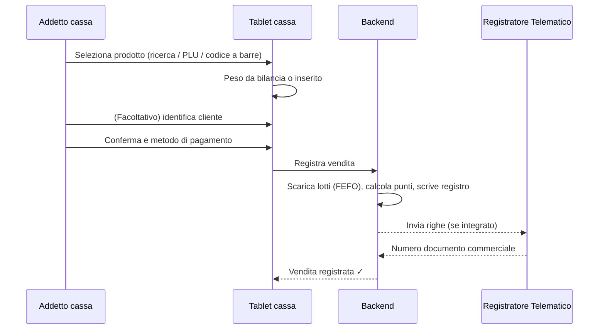

# 04 – Struttura dei moduli

## 1. Moduli trasversali (fondamenta)

Non visibili come voci di menu, ma usati da tutti gli altri:

| Modulo | Responsabilità |
|---|---|
| Identità e accessi | Login, 2FA, sessioni, recupero password, gestione utenti |
| Aziende e impostazioni | Tenant, sedi, preferenze, moduli attivi, marchio |
| Permessi | Verifica centralizzata `può(utente, azione, risorsa)` |
| Approvazioni | Coda unica delle operazioni da confermare |
| Consensi | Fonte unica di verità sui consensi; usato da WhatsApp, campagne, automazioni, AI |
| Registro attività | Scrittura automatica di ogni azione rilevante |
| Notifiche | Avvisi interni (campanella, email) |
| File | Caricamento e archiviazione sicura |
| Internazionalizzazione | Testi, formati data/numero/valuta, direzione del testo |
| Importazione/esportazione | CSV/Excel per anagrafiche, listini, inventario |

## 2. I 17 moduli funzionali

Per ciascun modulo: funzioni principali, dipendenze e fase di rilascio (vedi [08 – Roadmap](08-roadmap.md)).

| # | Modulo | Funzioni principali | Dipende da | Fase |
|---|---|---|---|---|
| 1 | **Dashboard direzionale** | Indicatori del giorno, confronti, avvisi, widget personalizzabili per ruolo | Vendite, Magazzino, Ordini, WhatsApp | 1 (base) → 5 (avanzata) |
| 2 | **Gestione clienti** | Anagrafica, schede, storico, note, duplicati, diritti GDPR | Consensi | 1 |
| 3 | **Segmentazione** | Segmenti dinamici e statici, etichette, RFM, anteprima con consensi | Clienti, Vendite | 3 |
| 4 | **Gestione vendite** | Cassa rapida, peso, sconti, cliente, pagamenti registrati, resi, chiusura cassa, collegamento RT | Prodotti, Listini, Magazzino, Clienti | 1 |
| 5 | **Catalogo prodotti** | Prodotti, categorie, origine/categoria/varietà, IVA, listini, promozioni, storico prezzi, cartellini | — | 1 |
| 6 | **Gestione magazzino** | Lotti, movimenti, giacenze, FEFO, scarti, inventario, soglie | Prodotti, Fornitori | 1 |
| 7 | **Gestione ordini** | Ordini clienti/prenotazioni/consegne; ordini fornitori e ricevimento merce; proposte di riordino | Clienti, Fornitori, Magazzino | 2 |
| 8 | **Gestione fornitori** | Anagrafica, listini d'acquisto, documenti, valutazioni | — | 2 |
| 9 | **Integrazione WhatsApp** | Casella condivisa, assegnazione, risposte rapide, modelli, opt-in/STOP, notifiche ordini | Clienti, Consensi | 3 |
| 10 | **Campagne marketing** | Creazione, approvazione, invio programmato, limiti, statistiche | Segmentazione, WhatsApp, Consensi, Approvazioni | 3 |
| 11 | **Programma fedeltà** | Regole punti, tessera digitale, premi, riscatto in cassa, scadenze | Clienti, Vendite | 3 |
| 12 | **Fidelizzazione e recupero** | Rilevamento clienti a rischio, azioni di recupero proposte, ricorrenze | Segmentazione, Campagne | 4 |
| 13 | **Recensioni e referral** | Richieste recensione, feedback interno, codici presenta-un-amico | Clienti, WhatsApp, Fedeltà | 4 |
| 14 | **Analisi delle performance** | Vendite, margini, rotazione, scarti, clienti, campagne | Tutti i moduli dati | 5 |
| 15 | **Assistente AI** | Domande sui dati, bozze, proposte con approvazione | API, Permessi, Approvazioni | 5 |
| 16 | **Automazioni** | Regole evento/condizione/azione, pianificazioni, registro esecuzioni | Eventi di dominio, Consensi, Approvazioni | 4 |
| 17 | **Report finanziari e operativi** | Incassi, IVA, acquisti, margini, magazzino; esportazione PDF/Excel | Vendite, Fornitori, Magazzino | 2 (base) → 5 |

## 3. Flussi principali

### 3.1 Vendita al banco

Se l'RT non è integrato, l'operatore batte lo scontrino sull'RT come oggi e il sistema importa i corrispettivi giornalieri per la riconciliazione.

### 3.2 Ricevimento merce

Ordine al fornitore → arrivo merce → controllo quantità e qualità → creazione lotti con origine e costo → aggiornamento giacenze → eventuale aggiornamento prezzo di acquisto → proposta (non automatica) di aggiornamento del prezzo di vendita in base al margine obiettivo.

### 3.3 Campagna WhatsApp

Bozza (manuale o da AI) → scelta segmento → calcolo destinatari con consenso valido → anteprima → **richiesta di approvazione** → approvazione del Titolare → invio graduale dal worker con controllo consenso al momento dell'invio → statistiche.

### 3.4 Proposta dall'assistente AI

Domanda dell'utente → l'AI legge i dati con i permessi dell'utente → risposta con fonti → eventuale proposta → richiesta di approvazione con istantanea dei dati → approvazione/rifiuto umano → esecuzione da parte del sistema (non dell'AI) → registro attività.

## 4. Interfacce tra moduli

I moduli comunicano in due modi:

1. **Chiamate dirette a servizi pubblici del modulo** (es. `MagazzinoService.scarica(lotti)` chiamato da Vendite) all'interno della stessa transazione quando serve coerenza immediata.
2. **Eventi di dominio** (es. `VenditaRegistrata`, `ConsensoRevocato`, `LottoInScadenza`) salvati nella tabella outbox e consegnati in modo affidabile al worker per effetti successivi (statistiche, automazioni, notifiche).

Un modulo non accede mai direttamente alle tabelle di un altro modulo.
