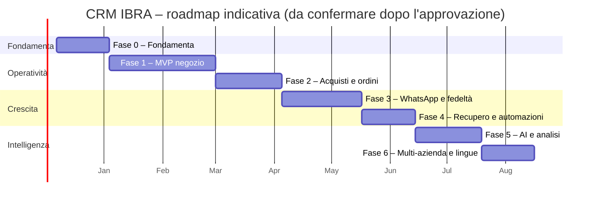

# 08 – Roadmap di sviluppo

## 1. Metodo

- Sviluppo **iterativo a sprint di 2 settimane**, con dimostrazione al committente alla fine di ogni sprint.
- Ogni modulo è considerato **completato** solo se soddisfa la "Definizione di Fatto":
  1. funzionalità implementate secondo i requisiti approvati;
  2. testi interamente in italiano dai file di traduzione;
  3. test automatici scritti e superati (unitari, integrazione, end-to-end dei flussi principali);
  4. permessi e registro attività verificati;
  5. documentazione tecnica e sezione del manuale utente aggiornate;
  6. revisione del codice e analisi di sicurezza superate;
  7. collaudo del committente sull'ambiente di prova.
- Le stime sono indicative per un team di 1–2 sviluppatori e verranno riviste dopo le risposte alle domande aperte.

## 2. Fasi

### Fase 0 – Fondamenta (≈ 3–4 settimane)
- Monorepo, CI/CD, ambienti sviluppo/collaudo/produzione.
- Database, migrazioni, Row-Level Security multi-azienda.
- Autenticazione, 2FA, sessioni, PIN di cassa.
- Ruoli e permessi, modulo Approvazioni, Registro attività, Consensi (base).
- Struttura i18n (italiano) e sistema grafico.
- Backup automatici e prova di ripristino.
- Tenant dimostrativo separato con banner.

**Rilascio:** piattaforma vuota ma sicura, accesso utenti.

### Fase 1 – MVP operativo in negozio (≈ 6–8 settimane)
- Catalogo prodotti, categorie, IVA, listini, storico prezzi, cartellini.
- Magazzino: lotti, carichi, scarti, giacenze, inventario.
- Clienti: anagrafica, consensi, ricerca, duplicati.
- Vendite: cassa da tablet, peso, cliente, pagamenti registrati, resi, chiusura cassa; collegamento RT/importazione corrispettivi (in base all'hardware).
- Cruscotto base.
- Importazione dati esistenti (clienti, prodotti) se disponibili.

**Rilascio:** **prima messa in uso reale** in negozio, con affiancamento.

### Fase 2 – Acquisti e ordini (≈ 4–5 settimane)
- Fornitori, listini d'acquisto, documenti.
- Ordini d'acquisto e ricevimento merce con generazione lotti.
- Ordini clienti, prenotazioni, consegne.
- Proposte di riordino (con approvazione).
- Report base: incassi, IVA, acquisti, esportazioni per commercialista.

### Fase 3 – Comunicazione e fedeltà (≈ 5–6 settimane)
- Integrazione WhatsApp Business (casella, risposte, modelli, opt-in/STOP, notifiche ordini).
- Segmentazione e RFM.
- Campagne con approvazione e limiti.
- Programma fedeltà con tessera digitale e riscatto in cassa.

*Prerequisito:* account Meta Business verificato e numero dedicato (le tempistiche di verifica dipendono da Meta).

### Fase 4 – Crescita clienti e automazioni (≈ 4 settimane)
- Recupero clienti a rischio.
- Recensioni e feedback, referral.
- Motore automazioni con registro esecuzioni.

### Fase 5 – Intelligenza e analisi (≈ 4–5 settimane)
- Assistente AI con strumenti di lettura, bozze e proposte con approvazione.
- Analisi delle performance avanzate.
- Report finanziari e operativi completi; cruscotto avanzato.

### Fase 6 – Prodotto multi-azienda (≈ 4 settimane)
- Registrazione e configurazione di nuove aziende, marchio personalizzato.
- Traduzione in inglese e arabo (con layout RTL).
- Moduli attivabili per azienda, multi-sede completo.
- Manuale utente completo, documentazione per installazioni future.

**Durata complessiva indicativa:** 7–9 mesi per tutte le fasi; l'MVP utilizzabile in negozio è previsto dopo circa 2,5–3 mesi.

## 3. Cronoprogramma

Le date partono dall'ipotesi di approvazione entro inizio dicembre 2026 e includono la pausa natalizia solo in modo approssimativo.

## 4. Rischi principali

| Rischio | Impatto | Mitigazione |
|---|---|---|
| RT o bilancia non integrabili | Doppia digitazione in cassa | Importazione corrispettivi; valutazione di sostituzione hardware con il fornitore della cassa |
| Verifica Meta lenta o rifiutata | Ritardo Fase 3 | Avvio pratica Meta durante Fase 1 |
| Connessione internet instabile in negozio | Blocco vendite | Modalità offline della cassa |
| Dati esistenti assenti o disordinati | Avvio lento | Importazione guidata e inserimento progressivo |
| Tempo limitato del personale per formazione | Scarsa adozione | Interfaccia semplice, affiancamento, video brevi |
| Costi API (WhatsApp, AI) | Spese ricorrenti | Stima dei costi prima dell'attivazione, limiti di spesa configurabili |
| Requisiti normativi (fedeltà, fiscale) | Rischio sanzioni | Validazione con commercialista/consulente prima del rilascio dei moduli interessati |
