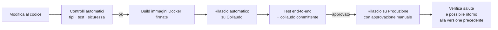

# 10 – Strategia di pubblicazione online

## 1. Ambienti

| Ambiente | Scopo | Dati |
|---|---|---|
| Sviluppo | Lavoro degli sviluppatori | Fittizi |
| Collaudo (staging) | Prove del committente prima di ogni rilascio | Fittizi / dimostrativi |
| Produzione | Uso reale in negozio | Reali |
| Demo | Presentazioni a futuri clienti | Dimostrativi, segnalati |

## 2. Opzioni di hosting (tutte in UE)

| Opzione | Descrizione | Pro | Contro | Costo indicativo* |
|---|---|---|---|---|
| **A – Server virtuale gestito da noi** (es. Hetzner Germania, Aruba Italia) con Docker | 1 server applicativo + database gestito o su server separato | Costi contenuti, controllo totale | Più manutenzione sistemistica | Basso |
| **B – Piattaforma cloud gestita** (es. AWS Milano, Google Cloud Milano/Torino, Azure Italia) | Database gestito, container gestiti, backup integrati | Alta affidabilità, scalabilità | Costi più alti e più complessità | Medio-alto |
| **C – Ibrida** | Applicazione su server virtuale, database e backup su servizio gestito | Buon equilibrio | — | Medio |

\*I costi effettivi vanno quotati al momento della scelta: non vengono indicate cifre per non fornire dati non verificati.

**Raccomandazione:** partire con l'**opzione C** (o A per budget minimo) per una singola azienda, con migrazione già prevista verso l'opzione B quando il prodotto ospiterà più aziende.

## 3. Componenti in produzione

- Reverse proxy con HTTPS automatico (certificati Let's Encrypt).
- Container: `web`, `api`, `worker`.
- PostgreSQL 16 con backup continuo e replica fuori sede.
- Redis.
- Archivio file compatibile S3 in UE.
- Monitoraggio: disponibilità (controlli esterni), errori applicativi (es. Sentry in regione UE o self-hosted), metriche e log centralizzati.
- Dominio: es. `gestionale.<dominio-negozio>.it` (da definire).

## 4. Rilascio continuo (CI/CD)

- Migrazioni del database **compatibili all'indietro**, per poter tornare alla versione precedente.
- Rilasci in produzione fuori dall'orario di apertura del negozio.
- Ogni versione ha numerazione semantica e note di rilascio in italiano.

## 5. Avvio in negozio (go-live)

1. Configurazione azienda, utenti, ruoli, aliquote IVA, prodotti e listini.
2. Importazione dati esistenti (se presenti) con verifica a campione.
3. Configurazione tablet di cassa (PWA, dispositivo registrato, bilancia/RT).
4. Formazione del personale (sessioni brevi per ruolo) e consegna del manuale utente.
5. **Periodo di affiancamento** di 1–2 settimane, eventualmente in parallelo al metodo attuale.
6. Verifica giornaliera della quadratura cassa e del magazzino nel primo periodo.

## 6. Manutenzione e assistenza

- Aggiornamenti di sicurezza tempestivi.
- Monitoraggio con avvisi automatici.
- Prova di ripristino mensile.
- Revisione trimestrale di accessi, costi e prestazioni.
- Canale di segnalazione problemi con tempi di risposta da concordare.

## 7. Documentazione consegnata

- **Manuale utente** in italiano, per ruolo, con schermate.
- **Documentazione tecnica**: architettura, API (OpenAPI), database, procedure operative (rilascio, backup, ripristino, gestione incidenti).
- **Documenti privacy**: modello di informativa, registro dei trattamenti, elenco sub-responsabili, procedura violazioni.
